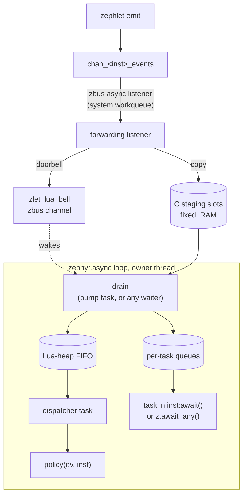

# Lua frontend

`CONFIG_ZEPHLETS_LUA=y` exposes the instances of every zephlet type that opts
in with `lua:true` in its options file to a Lua script as the `zephlets`
module. It covers commands, events and enum constants. Zephlet code
and the core C API stay unchanged. The scheduler is lua_zephyr's
`zephyr.async`; this frontend adds no scheduler of its own.

```lua
local z = require("zephlets")

local tick      = z.tick_timer_based_impl
local tampering = z.tampering_emul_impl
local ui        = z.ui_fake_impl

tick:add_policy(function(ev)
    ui:blink(100)
end)

tampering:add_policy(function(ev)
    if ev.proximity_tamper_detected then
        ui:blink(100)
    end
end)
```

```cmake
# CMakeLists.txt, after find_package(Zephyr): precompile src/app.lua into
# app_lua_bytecode.h (lua_zephyr's luaz.cmake).
luaz_add_bytecode_file(src/app.lua)
```

```c
#include <zephlet_lua.h>

#include "app_lua_bytecode.h"

int main(void)
{
	/* C setup first: this call does not return while the script runs. */
	return zephlet_lua_coordinate(ZEPHLET_LUA_SCRIPT(app));
}
```

## Setup

1. Put [lua_zephyr](https://github.com/zano-systems/lua_zephyr) in your west
   manifest. Pin it by SHA, and set `submodules: true` because the Lua core is
   a submodule. This frontend was developed and tested against
   `58c47e5bdb40f7cdaea3a05db2b5fcc81226b5a6`, the head of
   `feat/async-coroutine-scheduler`. If the module is missing,
   `CONFIG_ZEPHLETS_LUA` cannot be enabled (`depends on LUA_ASYNC`) and
   nothing Lua is built. Put
   [zephyr-nanopb-textformat](https://github.com/rodrigopex/zephyr-nanopb-textformat)
   in the manifest too, pinned by tag: `CONFIG_ZEPHLETS_LUA` selects
   `NANOPB_TEXTFORMAT` for its message descriptors.
2. Kconfig:

   ```
   CONFIG_LUA=y
   CONFIG_LUA_ASYNC=y
   CONFIG_ZEPHLETS_LUA=y
   # Libraries the script uses, e.g. CONFIG_LUA_LIB_STRING=y,
   # or all of them with CONFIG_LUA_LIBS_ALL=y.
   ```

3. Embed the script with `luaz_add_bytecode_file(<path>.lua)` and call
   `zephlet_lua_coordinate(ZEPHLET_LUA_SCRIPT(<name>))` from `main()`.
   `CONFIG_ZEPHLETS_LUA` selects `CONFIG_LUA_PRECOMPILE`, so a host `luac` is
   built and every script is compiled to stripped bytecode at build time,
   the frontend's own tasks included. Add `CONFIG_LUA_PRECOMPILE_ONLY=y` to
   leave the Lua parser out of the image (about 20 KB of flash on Cortex-M3).
   `zephlet_lua_coordinate(buf, len, chunkname)` also takes source, for
   example a script read from a filesystem, when the parser is kept.

4. Opt each zephlet type the script uses in, either in the options file
   beside its `.proto` (`zlet_tick.proto` → `zlet_tick.zephlet.options`),
   whose syntax is that of nanopb's `.options` files:

   ```
   TickApi lua:true
   ```

   or in the `.proto` itself, with `import "zephlet_options.proto";` and
   `option (zephlet.lua) = true;` in the service. See
   [Frontend options](../../README.md#frontend-options).

No other wiring is needed. For an opted-in type, the per-type hook that
`ZEPHLET_NEW(...)` already expands registers every instance with the
frontend. Instances are found by name in an iterable section; the
application declares no list of them. A type without the option gets no
bindings, record or listener, so it costs nothing: in the example app that
keeps the 43-RPC `typelab` out: 1.6 KB of flash and 96 B of RAM. Its
instances are unknown names to the script.

## The `zephlets` module

| Expression | Meaning |
|---|---|
| `z.<instance>` | The instance object. An unknown name raises an error. |
| `inst:<rpc>(timeout_ms)` | A command whose request is `Empty`. |
| `inst:<rpc>(req, timeout_ms)` | A command with a request table. |
| `inst:add_policy(fn)` | Adds a policy: `fn(ev, inst)` runs for every event of `inst`. |
| `inst:await([timeout_ms])` | From a `zephyr.async` task: the next event of `inst`. |
| `z.await_any(insts[, timeout_ms])` | From a task: the next event of any instance in the array `insts`, as `ev, inst`. |
| `inst.<Enum>.<VALUE>` | Proto enum constants, read-only. Proto names are kept verbatim. |
| `z.FOREVER` | `-1`, the `timeout_ms` that means `K_FOREVER`. |
| `z.stats()` | Per-instance counters, keyed by instance name. They saturate at `math.maxinteger` (2^31 - 1). |

The module, the instances and the enum tables are all read-only. An instance
named `stats`, `FOREVER` or `await_any` cannot be reached from Lua, since the
module's own fields win; the frontend logs a warning at start for one.

### Commands

```lua
local cfg, err, rc = tick:config({duration_ms = 0, period_ms = 1000}, 500)
if not cfg then
    print("config failed", err, rc)    -- e.g. nil, "EINVAL", -22
end
```

- **`timeout_ms` is required**: a plain integer, where `0` means `K_NO_WAIT`
  and `z.FOREVER` means `K_FOREVER`. There is no default. It bounds the wait
  for the command channel, exactly as in the C wrappers.
- A command goes through the generated typed wrapper (`<type>_<rpc>()`), the
  same path a C caller takes. The handler runs on the caller's thread, which
  here is the thread that called `zephlet_lua_coordinate()`.
- **Success** returns the response table, or `true` for `Empty`. **Failure**
  (`rc != 0`) returns `nil, "<ERRNO>", rc`.
- **A command cannot start while another converts its request or response**,
  which only a `__gc` metamethod that calls a command can attempt: it raises
  instead of overwriting the first command's data.
- **Invalid arguments raise an error** instead of returning one, because they
  are bugs in the script, not runtime conditions. That covers a wrong
  argument count, a missing or invalid timeout, an unknown field, a value of
  the wrong type, an integer out of range, a string or bytes value too long,
  too many repeated elements, two members of one oneof, and calling with `.`
  instead of `:`.

### Messages as tables

Request, response and event fields follow the proto field names:

| Proto | Lua |
|---|---|
| scalar (proto3 implicit presence) | always present; `0`/`false`/`""` when unset |
| `optional` scalar, submessage | `nil` when absent |
| `repeated` | array (`{}` when empty) |
| enum | integer; compare with `inst.<Enum>.<VALUE>` |
| `string`, `bytes` | Lua string; `bytes` may contain NUL |
| `oneof` | only the member that is set |
| `float`, `double` | number |

The conversion walks the nanopb-textformat descriptors that codegen already
emits for every message. No second schema parser is involved. Those exist only
for the messages of the zephlet's own proto (and `Lifecycle.Status`), so an rpc
whose request or response is imported from another proto fails codegen for a
type with the `lua` option, rather than converting as `{}`.

**Integers are 32-bit.** lua_zephyr builds Lua with `LUA_32BITS`, so a Lua
integer is 32-bit and a Lua number is a `float`. Reading a `uint32` above
`2^31 - 1`, or a 64-bit value outside the `int32` range, gives a number, which
may round. Writing one of those values only works as an integral number, with
the same caveat. The field's own range is checked exactly: `-2^63` fits an
`int64` and `2^63` a `uint64`, while `2^64`, infinities and NaN are rejected.
`double` fields carry float precision.

### Events and policies

```lua
tick:add_policy(function(ev, inst)
    -- ev:   the event, e.g. ev.timestamp
    -- inst: the instance that emitted it, here tick
end)
```

- **An event is a read-only object, not a table.** It holds a copy of the C
  events struct, one allocation, and converts a field only when the script
  reads it, following [Messages as tables](#messages-as-tables). A
  submessage or repeated field is a new table on each read, so keep it in a
  local when using it more than once. Reading a field the event does not
  have raises an error, as does writing one. `pairs(ev)` walks the present
  fields in tag order. Every consumer of an event gets the same object.
- **No per-event metadata.** Drops are reported by the `z.stats()` counters
  only; the source of an event is the second argument.

- **Policies are static.** `add_policy` works only while the script's main
  chunk runs. Once the chunk returns the policies are sealed, and a later
  `add_policy` raises an error. An instance may have any number of policies.
  They run in the order they were added, and the lists live on the Lua heap.
  `add_policy` is a member of every instance, so codegen rejects an rpc or
  enum of that name in an opted-in type.
- **One persistent coroutine** runs every policy of every instance. No
  coroutine is created per event. Policies run one at a time, in the order the
  events were emitted.
- **A policy may park**, for example in `require("zephyr.async").sleep(ms)`.
  It is never resumed with anything other than its own reply; that is
  `zephyr.async`'s tagged-yield guarantee. While it is parked, later events
  wait in the FIFO and are handled in order afterwards. Do not call
  `coroutine.yield()` directly in a policy: an untagged yield ends the
  dispatcher task.
- **A policy that raises** has its error and traceback logged, and its
  instance's `handler_err` counter goes up. The remaining policies, and later
  events, still run.
- **Events emitted before the seal**, for example during boot or from the
  main chunk itself, are kept in staging, as far as its depth allows. Nothing
  empties staging before the seal, so when it is full the oldest event makes
  room for the new one, and the events the main chunk's commands cause are not
  crowded out by earlier ones from sources nobody uses. After the seal they go
  to the instances that have policies. Staged or overwritten events from
  instances with none are discarded without being counted as drops; an
  overwritten one of an instance with a policy counts as `staged_drop`.
  After the seal, those instances' events are filtered out in the listener.

### Waiting for events in a task

A policy reacts to each event on its own. To write a coordinator as
sequential code instead, wait for events from a `zephyr.async` task:

```lua
return function()
    local async = require("zephyr.async")

    async.spawn(function()
        while true do
            local ev = tick:await()                  -- parks this task only
            ui:blink(100)
        end
    end)

    async.spawn(function()
        while true do
            local ev, inst = z.await_any({tick, tampering}, 5000)
            if ev == nil then
                print("quiet for 5 s")               -- inst == "timeout"
            elseif inst == tampering then
                ui:blink(100)
            end
        end
    end)
end
```

- **`inst:await([timeout_ms])`** returns the next event of `inst`, the same
  object a policy gets, or `nil, "timeout"`. Without a timeout, or with
  `nil` or `z.FOREVER`, it waits forever: `tick:await()` returns only when tick
  emits. `0` does not wait. It parks the calling task,
  as `chan:await` does, never the thread.
- **`z.await_any(insts[, timeout_ms])`** waits on several instances at once,
  with the same timeout rules (`z.await_any({tick, tampering})` waits forever),
  like `observer:wait_msg`, and returns their events oldest first, as
  `ev, inst`, where `inst` is the instance that sent it.
- **Each task has its own queue per instance**, created by its first await on
  that instance. From then on every event of the instance is kept until the
  task takes it, including while the task does something else, up to
  `ZEPHLETS_LUA_AWAIT_DEPTH`. When the queue is full the newest event is
  dropped and counted as `await_drop`. The queue starts when the first await
  publishes it, and gets the events still in staging at that moment too.
  Events a policy's FIFO already took are not copied again, and those emitted
  while the instance had no consumer at all were never staged: they are gone.
- **Several tasks may await one instance**, and an instance may have policies
  too. Every consumer gets every event, as the same read-only object, as long
  as staging, the policy FIFO, its own queue and the Lua heap have room for
  it. An event that does not fit is a counted drop (see
  [Limits and memory](#limits-and-memory)).
- **Only from a task, after the seal.** Awaiting in the main chunk raises an
  error. Inside a `coroutine.wrap()`/`resume()` it raises as soon as it would
  park, as `zephyr.async` does for its own waits.
- An instance with no policy costs nothing until a task first awaits it. From
  then on its events are staged while a task that has awaited it is alive.
  Once every such task has finished, its next event stops the staging again,
  until a task awaits the instance anew. The queues themselves are freed by
  the garbage collector.
- `await` is a member of every instance, so codegen rejects an rpc or enum of
  that name, as it does for `add_policy`.

Policies and awaiting tasks complement each other. Policies share the one
dispatcher task, so a hundred of them still cost no task slot; use them for
independent reactions. Use await for logic that waits for one event and then
another, or that combines several sources.

### The main chunk and the async main

The main chunk runs **synchronously, before the scheduler starts**. It can
`require`, call commands and `add_policy`, but `zephyr.async` is not available
yet. To run background work, return a function from the chunk. It becomes one
more task when the loop starts:

```lua
return function()
    local async = require("zephyr.async")
    while true do
        async.sleep(10000)
        print(z.stats().tampering_emul_impl.staged_drop)
    end
end
```

`zephlet_lua_coordinate()` returns only on failure:

| Return | Cause |
|---|---|
| `-EALREADY` | The frontend was already started, by any thread. |
| `-ENOMEM` | The heap (`ZEPHLETS_LUA_HEAP_SIZE`) is too small to start: for the Lua state, the libraries, the frontend's prelude or the main chunk. |
| `-ENOEXEC` | The script did not load (a syntax error, which is logged). |
| `-EINVAL` | The main chunk raised an error other than running out of memory, or returned something other than nil or a function. |
| `-EFAULT` | The scheduler stopped on a fault, or the frontend's own prelude did not load or run (mixed Lua versions). |

Once it has returned, for whatever reason, the frontend stays stopped: the
listeners no longer stage events, so nothing fills up or counts drops.

## Architecture



- **No Lua runs in zbus listener context.** The forwarding listener, emitted
  per instance by the generated hook, copies the event struct into a staging
  slot under a spinlock and returns. It never blocks the workqueue. The Lua
  state, its `sys_heap` allocator and the scheduler state are owned by one
  thread and are not thread-safe, so this copy is the only cross-thread step.
- **The doorbell carries no data.** It is the one channel `zephyr.async`
  watches for the frontend. Its user data is a `lua_msg_descr`, as
  `chan:await` requires; zephlet channels carry a `struct zephlet *` there and
  cannot be awaited directly. A burst rings it once. A lost or coalesced
  doorbell loses no event, because each wakeup drains everything staged.
- **Two internal tasks.** Both the pump and the dispatcher drain staging,
  wrapping each event in a read-only object, whose fields its source's
  descriptor converts when read. Events of an
  instance with policies go into the Lua-heap FIFO; those of an awaited
  instance go into each awaiting task's queue. The pump exists so that staging
  keeps emptying while the dispatcher is parked inside a policy
  (`ZEPHLETS_LUA_PUMP`). The dispatcher is the one persistent policy
  coroutine.
- **Awaiting tasks wait on the doorbell too.** `await` drains, takes from the
  task's queues, and otherwise parks in `chan:await` on the doorbell, waking
  up for every doorbell and at least every `POLL_MS`. The queues and routing
  are C (`zephlet_lua_await.c`); only the loop that parks is Lua, in the
  prelude, since only Lua code can park a `zephyr.async` task. It is all
  built from the public `zephyr.async` API: lua_zephyr is not modified.
- **The scheduler never holds pointers into event buffers.** The listener
  copies, and the drain copies again into the event object. The zbus buffer is released
  as soon as the listener returns.

### Initialisation order

```mermaid
sequenceDiagram
    participant init as SYS_INIT walker
    participant main as main()
    participant fe as zephlet_lua_coordinate()
    participant lua as main chunk
    participant loop as zephyr.async loop

    init->>init: initialise the instances (APPLICATION level)
    Note over init: from here on their events are staged
    main->>fe: call, after the app's C setup
    fe->>fe: Lua state, libraries, zephlets module, prelude
    fe->>lua: run synchronously
    lua->>lua: add_policy(), setup commands
    lua-->>fe: nil, or the async main
    fe->>fe: seal: policies freeze, instances with one are marked
    fe->>loop: start the pump, the dispatcher and the async main
    Note over loop: from here on, tasks can await instances
    loop-->>fe: returns only on a fault
    fe-->>main: error code; the frontend stays stopped
```

## Limits and memory

| Kconfig | Default | Cost and effect |
|---|---|---|
| `ZEPHLETS_LUA_HEAP_SIZE` | 32768 | Static RAM for the Lua heap: the script, the queued events and policy lists. |
| `ZEPHLETS_LUA_SLOT_SIZE` | 64 | Payload of one staging slot. Every events struct must fit, which is checked at build time. |
| `ZEPHLETS_LUA_STAGING_DEPTH` | 8 | Staging slots. Static RAM is `(SLOT_SIZE + 8) × DEPTH`. |
| `ZEPHLETS_LUA_FIFO_DEPTH` | 32 | Events queued for the policies. Costs 2 B of static RAM each, plus each queued event on the Lua heap. |
| `ZEPHLETS_LUA_AWAIT_DEPTH` | 8 | Events kept per awaiting task and instance, on the Lua heap. |
| `ZEPHLETS_LUA_SCRATCH_SIZE` | 256 | Two static buffers for a command's request and response. Every RPC must fit, which is checked at build time. |
| `ZEPHLETS_LUA_PUMP` | y | The pump task: keeps staging empty while a policy is parked. About 1 KB of heap. |
| `ZEPHLETS_LUA_GC_PAUSE` | 100 | Heap growth, in % of what the last collection kept, before the next cycle starts. Lua's default of 250 only collects when an allocation fails on a heap this size. |
| `ZEPHLETS_LUA_GC_IDLE_STEP` | y | One GC step each time the dispatcher runs out of events, so a burst's garbage does not stay on the heap. |
| `ZEPHLETS_LUA_POLL_MS` | 1000 | How long an event can wait unnoticed after a refused doorbell. `0` turns the poll off. |
| `MAIN_STACK_SIZE` | 8192 (overridden) | The Lua VM and every command's handler run on this stack. |

**Heap budget.** Measured on mps2/an385 with the example application (three
instances, two policies, an async main; `prj_lua.conf`: no pump, 5 tasks, 1
channel), after a full collection:

| | Live |
|---|---|
| Empty Lua state | 3.1 KB |
| `base` library and preload entries | 1.6 KB |
| Frontend: registry tables and prelude | 3.1 KB |
| `app.lua` code | 2.8 KB |
| Its main chunk: module, instances, type metatables, `string`, policies | 3.5 KB |
| `zephyr.async` running: scheduler state, the tasks, doorbell ring | 3.9 KB |
| **Total** | **18.1 KB**, 20.9 KB peak |

The figures are `sys_heap` bytes, chunk overhead included. The last row
includes the task that took the readings. With the defaults (pump, 8 tasks,
8 channels) the total is 19.5 KB. A spawn beyond `LUA_ASYNC_MAX_TASKS` fails at
run time, so leave room for every task alive at once. Every task
coroutine costs about 1 KB, and the scheduler state grows with
`LUA_ASYNC_MAX_TASKS` × `LUA_ASYNC_MAX_CHANNELS`.

Each instance also has one record in RAM (flags and counters, `emitted`
among them) and one async listener.

The frontend's own tasks take 2 of `CONFIG_LUA_ASYNC_MAX_TASKS`, the
dispatcher and the pump, or 1 with `ZEPHLETS_LUA_PUMP=n`, and the build
requires one more, for the script's async main. A script that only adds
policies still pays for that slot: the build cannot see what its chunk
returns. `ZEPHLETS_LUA_PUMP=n` drops the pump
task, about 1 KB of heap, when no policy parks: while one does, its source's
later events wait in staging instead of the FIFO, so `STAGING_DEPTH` bounds
them. Size `LUA_ASYNC_MAX_TASKS` to the tasks alive at once (each costs
heap in the scheduler state even unused); the frontend awaits one channel,
so `LUA_ASYNC_MAX_CHANNELS=1` is enough unless the script awaits zbus
channels of its own. It uses one of
`CONFIG_LUA_ASYNC_MAX_CHANNELS` and one runtime zbus observer.

**After the seal, when a queue is full, the newest event is dropped and the
drop is reported, never silently.** Before the seal, staging overwrites its
oldest event instead, and counts that as `staged_drop` only for an instance
that has a policy at the seal; see "Events emitted before the seal" above.

| Where | Counter | Also |
|---|---|---|
| Staging full | `staged_drop` | `LOG_WRN` on the 1st, 2nd, 4th, 8th, … drop |
| FIFO full, or out of memory while converting | `fifo_drop` | Same |
| An awaiting task's queue full, or out of memory | `await_drop` | Same |
| Doorbell refused (zbus message pool exhausted) | `doorbell_fail` | Recovered by the next event or by `POLL_MS` |

`z.stats()` also reports `emitted`, `delivered` (to policies) and
`handler_err`.

**Allocations on the event path.** The listener allocates nothing on the Lua
heap. Per event, the drain allocates one event object, shared by every
consumer, under a protected call: an out-of-memory error drops the event and
counts it, and the scheduler does not fault. Measured on mps2/an385 with the
GC stopped, a one-field event costs about 93 B of heap through a policy or
an awaiting task, the doorbell's own message included; with event and meta
tables it was about 360 B. A zbus net_buf
carries each event to the async listener, and another carries the doorbell.
Both come from `ZBUS_MSG_SUBSCRIBER_NET_BUF_POOL_SIZE`, which you may need to
raise for bursts. lua_zephyr's allocator prints "Something went wrong with
allocation" whenever an allocation fails, including ones Lua then recovers
from with an emergency GC. Frequent messages mean the heap is too small.

## LuaLS

Each build writes `build/zephlets_lua/`:

- `zephlets_base.lua`: shared classes (`zephlets.Stats`,
  `pb.Lifecycle.Status`).
- `<prefix>_lua_meta.lua`, one per zephlet type the build links, generated
  from its proto: message classes with optional/repeated markers, `---@enum`,
  the instance class with every command's signature, and a typed
  `add_policy`. The files of a type removed or renamed since an earlier build
  are deleted.
- `zephlets_instances.lua`: the `zephlets` module with one field per instance.
  Codegen never sees instance names, which exist only in `ZEPHLET_NEW(...)`
  calls, so this file is written *after the link*. The per-instance record's
  symbol is `__zlet_lua__<type>__<instance>`, and a post-build step reads
  those symbols from the ELF. The file therefore lists exactly the instances
  that were built. That step needs `pyelftools` in the build's Python: it is
  in Zephyr's own requirements, and in `codegen/requirements.txt`.

Point LuaLS at it in the script's directory:

```json
{
  "runtime.version": "Lua 5.5",
  "workspace.library": ["../build/zephlets_lua"]
}
```

After that, `require("zephlets")` is typed. You get completion of instance
names, command names, request and event fields and enum values, and a
warning on a misspelled name.

## Known limitations

- The script must be started from one thread, which then owns the Lua state.
  Starting it a second time returns `-EALREADY`.
- Commands block that thread for their duration, and with it every Lua task.
  They are synchronous zbus calls, like the C wrappers.
- Scripts are stripped bytecode (`luac -s`), so Lua error messages carry no
  line numbers.
- 32-bit Lua numbers; see [Messages as tables](#messages-as-tables).
- Pointer- and callback-allocated nanopb fields, and `FIXARRAY` fields, are
  not converted. They are the same shapes nanopb-textformat skips.
- `coroutine.yield()` called directly in a policy ends the dispatcher. Park
  with `zephyr.async` calls instead.
- lua_zephyr pins Lua 5.5.0 (MIT), the `v5.5.0` release tag. The lua_zephyr
  repository has no LICENSE file yet, although its README states Apache-2.0.
